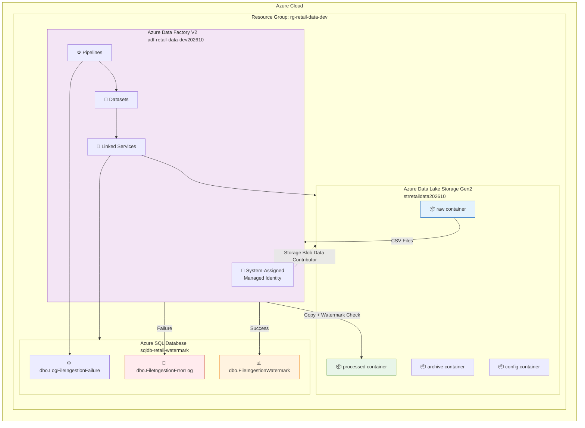
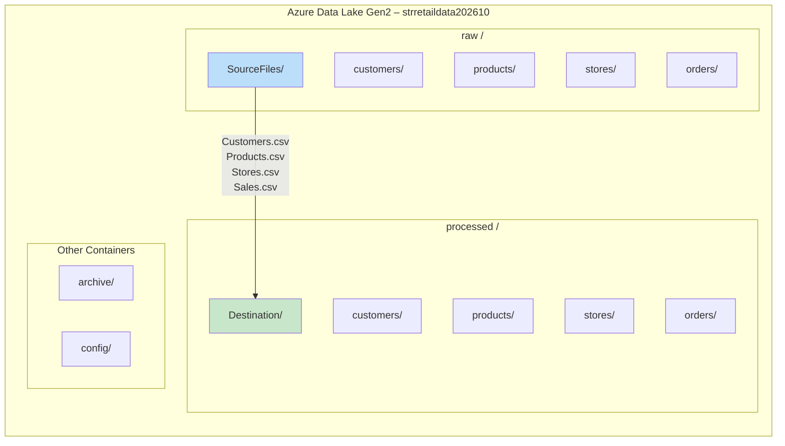
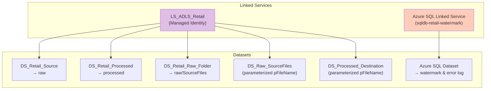
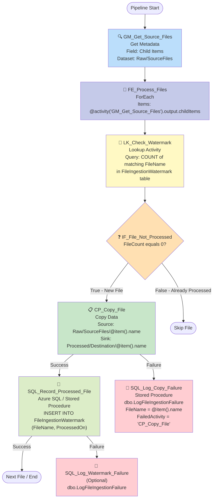
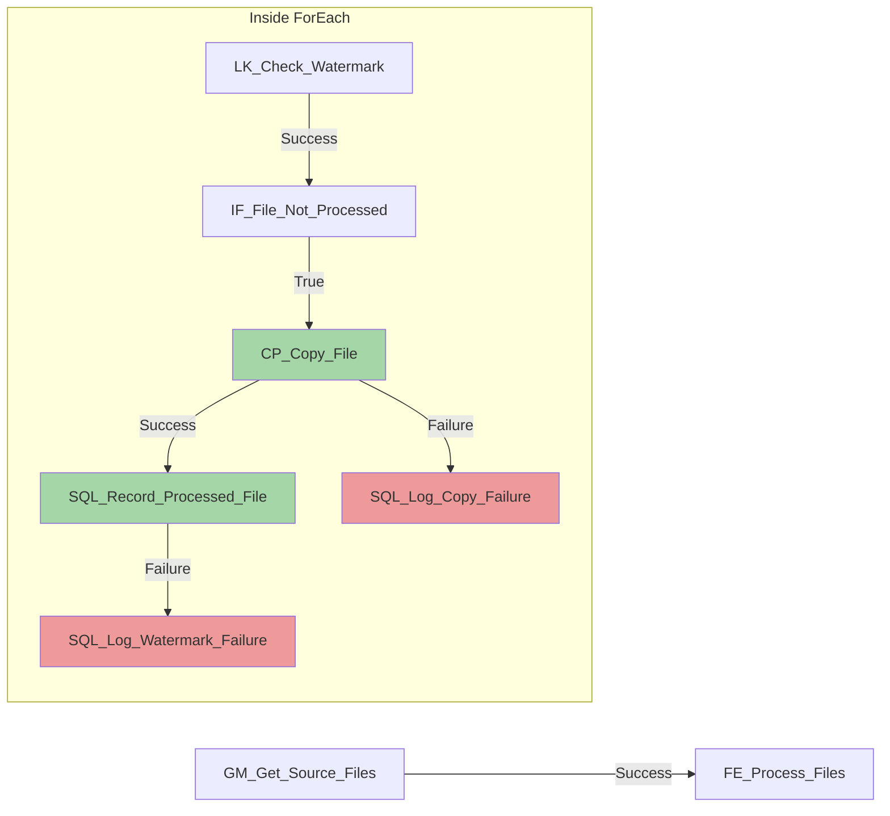
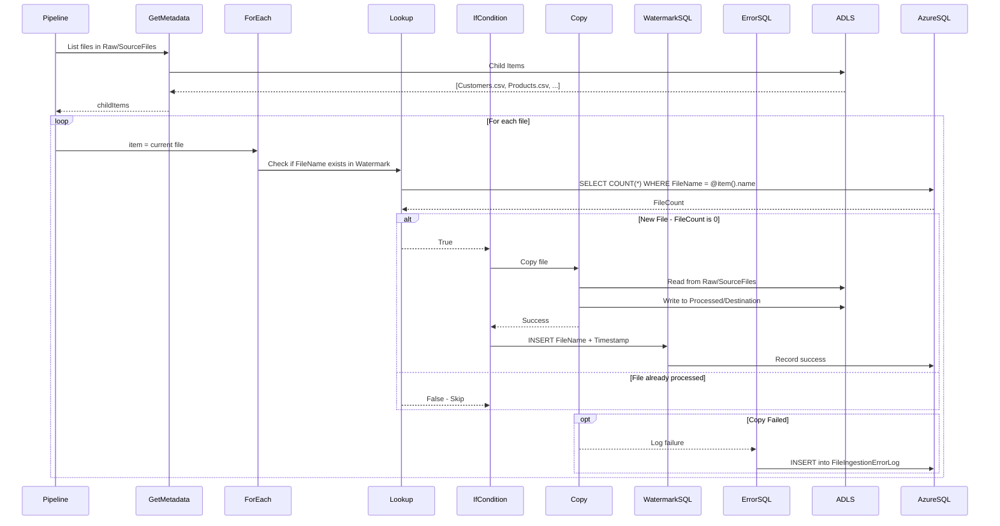
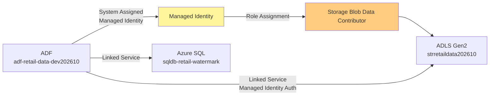

# 🏗️ ADF Retail Data Ingestion – End-to-End Architecture

> **Project**: `ADF-STEPBYSTEP-20261015`  
> **Goal**: Build a production-grade, incremental, fault-tolerant file ingestion pipeline from Azure Data Lake (Raw) → Processed using Azure Data Factory + Azure SQL Watermark & Error Logging.

---

## 1. High-Level End-to-End Architecture



---

## 2. Storage Layer – Detailed Structure



### Folder Structure (Exact)

```text
raw/
├── SourceFiles/                  ← Used in Step 9 & 10
│   ├── Customers.csv
│   ├── Products.csv
│   ├── Stores.csv
│   └── Sales.csv
├── customers/
│   └── customers.csv
├── products/
│   └── products.csv
├── stores/
│   └── stores.csv
└── orders/
    └── orders.csv

processed/
├── Destination/                  ← Target for dynamic/incremental copy
│   ├── Customers.csv
│   ├── Products.csv
│   ├── Stores.csv
│   └── Sales.csv
├── customers/
├── products/
├── stores/
└── orders/
```

---

## 3. Linked Services & Datasets Mapping



---

## 4. Pipeline Evolution Overview

| Step | Pipeline Name                        | Pattern                          | Key Activities                          |
|------|--------------------------------------|----------------------------------|-----------------------------------------|
| 8    | `PL_Retail_File_Ingestion`           | Recursive Wildcard Copy          | Copy Data (Recursive + Preserve Hierarchy) |
| 9    | `PL_Retail_File_Ingestion_Dynamic`   | Get Metadata + ForEach           | Get Metadata → ForEach → Copy           |
| 10   | `PL_Retail_File_Ingestion_Dynamic`   | **Incremental + Watermark**      | Get Metadata → ForEach → Lookup → If → Copy → SQL Insert |
| 11   | Same Pipeline                        | **Error Handling**               | + Failure paths to Stored Procedure     |

---

## 5. Detailed Incremental Load Pipeline (Step 10) – Micro Level



---

## 6. Activity Dependency Graph (Success vs Failure Paths)



---

## 7. Sequence Diagram – Incremental File Processing



---

## 8. Azure SQL Control Tables

### Watermark Table
```sql
CREATE TABLE dbo.FileIngestionWatermark
(
    FileName     VARCHAR(255) PRIMARY KEY,
    ProcessedOn  DATETIME2 NOT NULL DEFAULT SYSUTCDATETIME()
);
```

### Error Log Table
```sql
-- Columns
ErrorLogID      (Identity)
FileName
FailedActivity
ErrorMessage
FailedOn        (UTC)
```

### Stored Procedure
```sql
dbo.LogFileIngestionFailure
(
    @FileName       VARCHAR(255),
    @FailedActivity VARCHAR(255),
    @ErrorMessage   NVARCHAR(MAX)
)
```

---

## 9. Security & Identity Flow



---

## 10. Complete Component Checklist (Micro Level)

| Layer              | Component                              | Name / Value                              | Status |
|--------------------|----------------------------------------|-------------------------------------------|--------|
| **Resource Group** | Resource Group                         | `rg-retail-data-dev`                      | ✅     |
| **Storage**        | Storage Account                        | `strretaildata202610`                     | ✅     |
|                    | Containers                             | `raw`, `processed`, `archive`, `config`   | ✅     |
| **ADF**            | Data Factory                           | `adf-retail-data-dev202610`               | ✅     |
|                    | Managed Identity                       | System Assigned                           | ✅     |
| **Linked Service** | ADLS                                   | `LS_ADLS_Retail`                          | ✅     |
|                    | Azure SQL                              | (connection to watermark DB)              | ✅     |
| **Datasets**       | Source Folder                          | `DS_Retail_Raw_Folder`                    | ✅     |
|                    | Parameterized Source                   | `DS_Raw_SourceFiles` + `pFileName`        | ✅     |
|                    | Parameterized Destination              | `DS_Processed_Destination` + `pFileName`  | ✅     |
| **Pipeline**       | Main Pipeline                          | `PL_Retail_File_Ingestion_Dynamic`        | ✅     |
| **Activities**     | Get Metadata                           | `GM_Get_Source_Files`                     | ✅     |
|                    | ForEach                                | `FE_Process_Files`                        | ✅     |
|                    | Lookup                                 | `LK_Check_Watermark`                      | ✅     |
|                    | If Condition                           | `IF_File_Not_Processed`                   | ✅     |
|                    | Copy Data                              | `CP_Copy_File`                            | ✅     |
|                    | SQL Insert Watermark                   | `SQL_Record_Processed_File`               | ⚠️     |
|                    | SQL Log Copy Failure                   | `SQL_Log_Copy_Failure`                    | ✅     |
|                    | SQL Log Watermark Failure              | `SQL_Log_Watermark_Failure` (optional)    | ⚪     |
| **SQL Objects**    | Watermark Table                        | `dbo.FileIngestionWatermark`              | ✅     |
|                    | Error Log Table                        | `dbo.FileIngestionErrorLog`               | ✅     |
|                    | Stored Procedure                       | `dbo.LogFileIngestionFailure`             | ✅     |

---

## 11. Expected Runtime Behavior

| Run Scenario                        | Behavior                                      |
|-------------------------------------|-----------------------------------------------|
| First run (4 files)                 | All 4 files copied + recorded in watermark    |
| Second run (same 4 files)           | All files skipped (FileCount > 0)             |
| New file uploaded                   | Only new file copied + watermark updated      |
| Copy fails                          | Error logged in `FileIngestionErrorLog`       |
| Watermark insert fails              | Error logged (if optional path configured)    |

---

## 12. Quick Reference – Key Expressions

| Activity          | Expression / Setting                                      |
|-------------------|-----------------------------------------------------------|
| ForEach Items     | `@activity('GM_Get_Source_Files').output.childItems`      |
| If Condition      | `@equals(activity('LK_Check_Watermark').output.firstRow.FileCount, 0)` |
| File Name Param   | `@item().name`                                            |
| Dataset File Name | `@dataset().pFileName`                                    |
| Error Message     | `@string(activity('CP_Copy_File').error.message)`         |

---

**This document is ready for GitHub.**  
Just push `ARCHITECTURE.md` to the root of your repository. All Mermaid diagrams will render automatically on GitHub.
```
